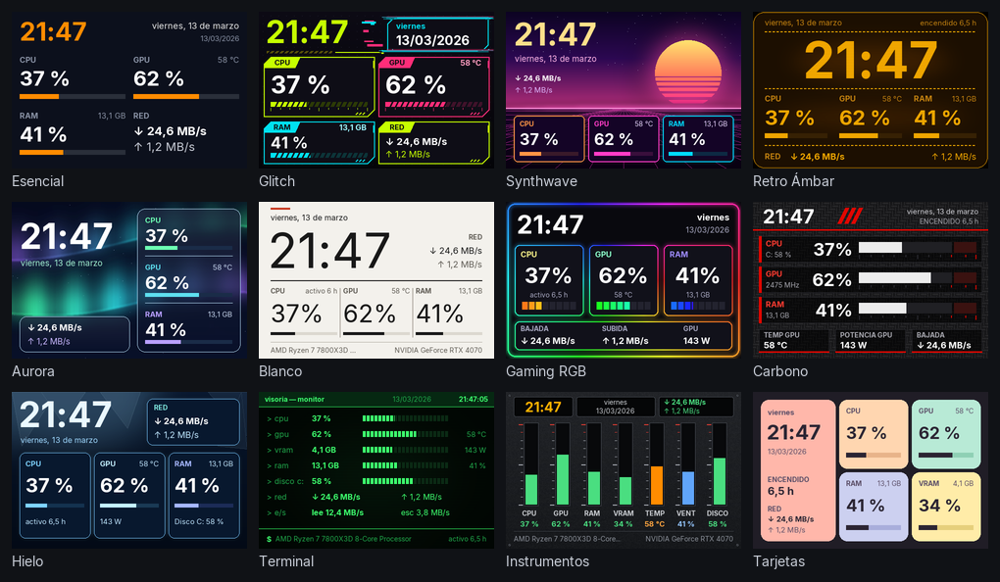

# Luzeira

Tu pantalla USB de monitorización del PC, en español y como tú quieras.

### [⬇ Descargar Luzeira para Windows](https://github.com/eriik-rz/luzeira/releases/latest)

¿Quieres verlo antes? [Prueba el editor en la web](https://eriik-rz.github.io/luzeira/demo/), sin instalar nada.

Luzeira es una app libre para las pequeñas pantallas USB que se ponen dentro o encima del PC (tipo *Turing Smart Screen* / *UsbPCMonitor*). Muestra la hora, el uso de CPU, GPU y RAM, la red, el disco y la temperatura de la gráfica, con 32 temas incluidos y un editor visual para hacer los tuyos, sin tocar ficheros.

## Qué la hace distinta

- **Fácil**: se instala con dos clics, arranca sola con Windows y se maneja desde el icono junto al reloj.
- **En español** de principio a fin, sin jerga.
- **Sin permisos de administrador**: ni para instalar ni para funcionar.
- **Ligera**: solo envía a la pantalla lo que cambia (unos pocos KB por segundo) y apenas usa CPU.
- **Respetuosa**: apaga la pantalla al apagar o suspender el PC y la vuelve a encender al volver; si desenchufas el cable, se reconecta sola.
- **Editor visual**: arrastra elementos, cambia colores y fondos, mira el resultado exacto antes de aplicarlo.
- **Segura y limpia**: sin anuncios y sin telemetría. Solo se conecta a internet si le dejas, para avisarte de versiones nuevas, y nunca instala nada sin que pulses «Actualizar». Los temas son datos, nunca programas.

## Instalar

1. Descarga `Luzeira-<versión>-instalador.exe` desde [Releases](https://github.com/eriik-rz/luzeira/releases/latest).
2. Ábrelo. Como Luzeira todavía no va firmada digitalmente, Windows puede mostrar **«Windows protegió su PC»**: pulsa **Más información → Ejecutar de todas formas**. Si quieres comprobar que la descarga es la oficial, mira [cómo verificarla](SECURITY.md#cómo-verificar-que-tu-descarga-es-oficial).
3. Sigue el asistente. Al terminar, Luzeira aparece junto al reloj y abre el editor para que veas lo que puedes hacer.

¿Prefieres no instalar nada? Descarga el `.zip` **portable**, descomprímelo donde quieras y abre `Luzeira.cmd`.

Para desinstalar: *Configuración → Aplicaciones → Luzeira*. Te preguntará si quieres conservar tus temas (por defecto, sí).

## Requisitos

- Windows 10 u 11 de 64 bits.
- El componente **Microsoft Edge WebView2** para el editor (viene con Windows 11 y con Edge; si falta, el instalador te lo dice).
- Los datos de la gráfica (uso, temperatura, consumo…) se leen, por ahora, solo en **tarjetas NVIDIA**. Con AMD o Intel el resto funciona y esos datos salen como «—».

## Pantallas soportadas

| Pantalla | Estado |
|---|---|
| Turing Smart Screen 3,5" / UsbPCMonitor 3,5" (revisión A, USB `1A86:5722`) | ✅ |
| Otras revisiones y tamaños | Más adelante |

## Licencia

[GPL-3.0-or-later](LICENSE). Puedes usarla, estudiarla, modificarla y compartirla; las versiones modificadas que distribuyas deben seguir siendo libres.

El nombre «Luzeira» identifica la versión oficial: las copias modificadas deben usar otro nombre.

## Créditos

- Fuente [Inter](https://github.com/rsms/inter) 4.1, de The Inter Project Authors, con licencia [SIL Open Font License 1.1](src/luzeira/recursos/fuentes/OFL.txt).
- Las licencias de todo lo que va dentro del instalador están en `TERCEROS.txt`, junto a la app.

## Seguridad

¿Has encontrado un fallo de seguridad? Lee [SECURITY.md](SECURITY.md) y repórtalo en privado.
